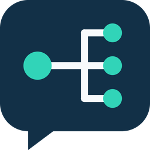

# Assist Router 1.2.1 für Home Assistant



Erste öffentliche Baseline für **BugsDan/ha-assist-router**, lokal vorbereitet. Eigenständige Custom Integration; kein offizielles Home-Assistant-Projekt. **Funktionsstand 1.2.1 bleibt erhalten. Einzige notwendige Bereinigung: Die alte 1.0-Migration verwendet keine private Default-URL mehr; sie verlangt einen explizit gespeicherten gültigen Endpunkt.**

Ein generischer Conversation-Router für vorhandene `conversation.*`-Entities. Reihenfolge und Anzahl sind frei konfigurierbar; mindestens ein Agent bleibt aktiv. Jeder Agent kann eine eigene optionale Health-Prüfung erhalten. Es gibt keine festen Providerrollen im Routing. Optional lassen sich gemeinsame Geschäftsanweisungen als geprüfter Zusatz zentral pflegen. Der Router schreibt keine bestehenden Agents, Prompts, Werkzeuge oder Automationen um; die einmalige Basisprompt-Neutralisierung erfolgt bewusst in deren vorhandenen HA-Dialogen.

**Sicherheitsregel:** Der Router wählt vor der Übergabe den ersten verfügbaren aktiven Agent. Nach einer Übergabe erfolgt bei Fehlern, Timeouts oder unklarem Ergebnis kein automatischer Aufruf eines anderen Agents für dieselbe Anfrage. Ein Werkzeug könnte bereits ausgeführt sein.

## HACS und sichere Übernahme

Das Ziel-Repository ist [BugsDan/ha-assist-router](https://github.com/BugsDan/ha-assist-router). In dieser Vorbereitung wurden weder Repository, Commit, Tag noch Release auf GitHub angelegt. Der folgende Ablauf gilt **erst nach gesonderter Veröffentlichung und grünen GitHub-Checks**:

1. HACS → Benutzerdefinierte Repositories → `https://github.com/BugsDan/ha-assist-router`, Typ **Integration** hinzufügen.
2. Assist Router öffnen, veröffentlichtes Release **1.2.1** herunterladen und HA neu starten. HACS liest `custom_components/assist_router` aus dem Release-Tag; die ZIP-Anhänge sind nicht als HACS-ZIP-Asset konfiguriert.
3. Nur bei einer Erstinstallation danach **Einstellungen → Geräte & Dienste → Integration hinzufügen → Assist Router** öffnen.

**Bereits manuell installiert? Bestehenden Config Entry weder löschen noch neu anlegen.** Vorher vollständiges HA-Backup, Codekopie ausserhalb `custom_components` sichern und laufende Aktionen abschliessen. HACS soll dieselbe Version erneut herunterladen und lediglich den Code unter `custom_components/assist_router` verwalten. Domain, Entry-ID, zentraler Prompt, Agent-Reihenfolge, Ergänzungen, Freigabe-Fingerprints und Health-Einstellungen bleiben in den vorhandenen HA-Config-Entry-Optionen. Keine `.storage`-Dateien manuell bearbeiten. Bis auf die entfernte implizite URL der 1.0-Migration ist der funktionale Code bytegleich; die tatsächliche HACS-Übernahme muss im eigenen HA abgenommen werden. Gesprächshistorie und nur im RAM gehaltene Safety-Sperren überleben einen HA-Neustart nicht: vor dem Wechsel unklare Aktionen am tatsächlichen Ziel prüfen, keine Aktion wiederholen, danach neue Conversations verwenden.

Ausführlicher Ablauf, Abbruchfälle und Rollback: [GitHub/HACS](docs/GITHUB_HACS.md). Entwicklung: [CONTRIBUTING.md](CONTRIBUTING.md). Veröffentlichungskontrolle: [Review](docs/PUBLISHING_REVIEW.md). Status der späteren Health-Automatik: [Roadmap](docs/ROADMAP.md).

Lizenz für eigene Integration, Werkzeuge und Originalgrafik: [MIT](LICENSE). Auditierte HA-/Local-OpenAI-Referenzen bleiben unter ihren bestehenden Apache-2.0-Lizenzen: [Drittanbieterhinweise](THIRD_PARTY_NOTICES.md). Sicherheitsmeldungen: [SECURITY.md](SECURITY.md).

## Installation / Update

1. HA-Konfiguration sichern.
2. `assist-router-1.2.1-public-baseline.zip` entpacken und den enthaltenen Ordner `custom_components/assist_router` nach `/config/custom_components/assist_router` kopieren. Einen vorhandenen Router-Ordner mit der neuen Version ersetzen; keine zusätzlichen Unterordner anlegen.
3. HA neu starten. Das Update von 1.2.0 behält Schema 3.1, Promptmodus und Reviews; geänderte Agent-Parameter erfordern weiterhin neue Freigabe. Bestehende 1.1.0-Einträge werden atomar auf Config-Entry-Version 3.1 erweitert. Gemeinsame Prompts sind standardmässig deaktiviert; Routing, Health-Zuordnung, Prioritäten, Zugangsdaten und bisherige Promptweitergabe bleiben erhalten. Auch 1.0.0 wird mit unveränderter ehemaliger Reihenfolge und Health-Zuordnung migriert, sofern `models_url` explizit und gültig gespeichert ist. Fehlt dieser Wert, stoppt die Migration ohne Änderung; es wird kein privater oder geratener Endpunkt eingesetzt. Hinweise für diesen Legacy-Sonderfall stehen in docs/GITHUB_HACS.md. Kein Ziel-Agent wird automatisch verändert. Bei ungültiger alter Konfiguration wird die Migration ohne Umschreiben abgelehnt.
4. Neue Einrichtung: **Einstellungen → Geräte & Dienste → Integration hinzufügen → Assist Router**. Bei bestehendem Eintrag **Konfigurieren** wählen.
5. In den gewünschten Assist-Pipelines **Assist Router** wählen und **«Befehle bevorzugt lokal verarbeiten» aktiviert lassen**. Die Integration ändert keine Pipeline automatisch.

Der Entity-Name ist normalerweise `conversation.assist_router`, kann bei Konflikten abweichen. Seine bisherige Unique-ID bleibt beim Update erhalten. Es sind keine Änderungen an HA-Core, Local OpenAI oder Yuvomi MCP erforderlich. Die bestehende Einkaufslisten-Automation wird nicht verändert.

## Bedienung vollständig über die HA-Oberfläche

1. **Agents auswählen, sortieren oder entfernen:** Vorhandene Conversation-Entities über den HA-Entity-Selektor auswählen. Reihenfolge von oben nach unten festlegen; der Selektor verwendet die in HA 2026.10.2 unterstützten Optionen `multiple` und `reorder`. Neue Agents sind zunächst aktiv, entfernte Agents verlieren ihre Router-Health-Einstellungen erst beim Speichern.
2. **Position eines Agents ändern:** Alternative zur sortierbaren Liste. Agent auswählen und Position eingeben; 1 ist die höchste Priorität.
3. **Agents aktivieren oder deaktivieren:** Eine Auswahl der aktiven Agents. Nicht ausgewählte Einträge bleiben samt Health-Konfiguration erhalten. Die Reihenfolge wird dadurch nicht verändert. Das Deaktivieren oder Entfernen des letzten aktiven Agents wird abgewiesen.
4. **Health-Prüfung eines Agents bearbeiten:** Agent, Prüftyp und Einstellungen auswählen. Auch deaktivierte Agents können vorab konfiguriert werden. Mit Prüftyp **Keine** wird die zugehörige Prüfung entfernt.
5. **Speichern:** Erst jetzt wird der vollständige Entwurf übernommen und die Integration neu geladen. Abbrechen des Dialogs verwirft den Entwurf. Zugangsdaten erscheinen nicht als Formularvorgabe und werden auch nach Validierungsfehlern nicht zurückgespiegelt.

Die Übersicht zeigt Priorität, Aktivierung und Prüftyp. Reihenfolge, Aktivierung und Health-Prüfung sind an die **Entity-ID** gebunden, nicht an Listenpositionen. Beim Sortieren oder Deaktivieren wandert die Prüfung daher nicht versehentlich zu einem anderen Modell. Beim Umbenennen oder Ersetzen einer Agent-Entity die Auswahl im Router anpassen; eine neu hinzugefügte Entity erhält keine fremde Health-Prüfung.

Es gibt keine Begrenzung auf drei Agents und keine vorgegebenen Agent- oder Modellnamen bei neuer Einrichtung. Der native Home-Assistant-Agent sowie alle registrierten Assist-Router-Entities sind als Routing-Ziele ausgeschlossen. Fehlende/entladene Zielintegrationen führen vor einer Übergabe zum Überspringen; `unknown` allein gilt nicht als Ausfall, da Conversation-Entities vor ihrem ersten Aufruf noch keinen Aktivitätszeitstempel besitzen können.

## Seit 1.2.0, Parameterfreigabe ab 1.2.1: Zentrale Geschäftsanweisungen als Zusatz

**Standardmässig deaktiviert.** Der Router kann gemeinsame mehrzeilige Anweisungen und optionale Ergänzungen pro Agent über `extra_system_prompt` übergeben. Das ersetzt keine Agent-, HA- oder Werkzeuginstruktionen exklusiv. Die einmalige Neutralisierung alter Geschäftsregeln erfolgt bewusst **manuell in den vorhandenen Agent-Dialogen**. Der Router liest fremde Config Entries, schreibt sie aber niemals um.

1. Alte Agent-Prompts sichern und Geschäftsregeln in **Gemeinsamen Prompt bearbeiten** übertragen. Aktivierung vorerst aus lassen. Optional **Individuelle Agent-Ergänzung bearbeiten** verwenden.
2. Für jeden aktiven Agent **Agent-Basisprompt prüfen und freigeben** öffnen. Die dort sichtbare neutrale Vorlage exakt in dessen vorhandenem HA-Konfigurationsdialog als Basisprompt speichern; Werkzeugauswahl beibehalten. Reload abwarten. Diese Umstellung in einem Wartungsfenster durchführen: Bis zur Aktivierung fehlt den neutralisierten Agents der neue Router-Zusatz.
3. Prüfschritt erneut öffnen. Nur Status `ready` lässt sich freigeben; vollständige SHA-256-Fingerprints sind sichtbar. **Alle aktiven Agents** benötigen eine aktuelle Freigabe. Local OpenAI erlaubt ab 1.2.1 ausschliesslich eng geprüfte Zusatzparameter: `reasoning_effort=none` und konstantes `enable_thinking=false` beim geprüften llama.cpp-Mixin. Andere oder dynamische Parameter bleiben gesperrt. Auch erlaubte Parameter bleiben vollständig im Fingerprint und müssen nach Änderungen erneut freigegeben werden. Details und gültige Speicherformen stehen in der Prompt-Anleitung.
4. Gemeinsame Zusätze aktivieren, additive Wirkung bestätigen und **Speichern** wählen. Danach **ein neues Gespräch** beginnen. Alte Conversations werden angehalten, nicht umgeschrieben oder automatisch wiederholt. Änderungen und Abschalten verlangen ebenfalls neue Gespräche.

Vor jeder Übergabe prüft der aktivierte Modus die Konfiguration aller aktiven Agents erneut, auch nach einer wartenden Health-Prüfung. Unbekannte Quellen, abweichende Basisprompts und geänderte Fingerprints stoppen die gesamte Übergabe. Es erfolgt **kein stiller Wechsel auf Cloud** wegen einer fehlgeschlagenen Promptprüfung. Bei unveränderter Konfiguration funktioniert der bisherige Health-Fallback weiterhin.

Die Quellfreigabe ist bewusst eng: HA OpenAI/Google 2026.10.2 und die nachgewiesenen Local-OpenAI-Quelldateien am Commit `37b2334b2c5e5085a0c1081092fff238980e27ac` (Tag 1.13.0, Manifest intern 1.12.1). Die installierte Local-OpenAI-Version ist unbekannt. Eine abweichende Installation kann den Zusatzmodus deshalb blockieren; keine Versionsnummer raten und keine Hashprüfung umgehen. Im ausgeschalteten Modus bleiben beliebige bestehende Agents nutzbar.

Werkzeugprompts, dynamischer HA-Kontext, Providerregeln, Backend-Chatvorlagen und bereits serverseitig gespeicherte Inhalte bleiben ausserhalb einer exklusiven Routerkontrolle. Ein Fingerprint bestätigt gespeicherte Konfiguration und geprüfte Quellpfade, keine semantische Befolgung durch das Modell. Details, Statuscodes und sichere Abnahme: [Promptverwaltung](docs/PROMPT_VERWALTUNG.md), [Quellprüfung und Grenzen](docs/PROMPT_KOMPATIBILITAET_1.2.0.md).

## Health-Prüfungen pro Agent

| Prüftyp | Bedeutung |
|---|---|
| Keine | Nur Existenz und HA-Entity-Verfügbarkeit prüfen. Kein zusätzlicher Netzwerkaufruf. |
| HTTP-Status | Lesender GET auf den konfigurierten Endpunkt. Nur der konfigurierte erfolgreiche Status gilt als bereit. Keine JSON-Antwort nötig. |
| LM Studio | Lesender GET auf den vollständigen `/api/v1/models`-Endpunkt, erfolgreicher HTTP-Status und Prüfung des exakten Modell-/Instanzzustands. |

Pro Agent konfigurierbar:

- Vollständige HTTP(S)-URL. Keine URL-Zugangsdaten, Query-Parameter oder Fragmente; Redirects werden nicht verfolgt. Bei LM Studio normalerweise `http://lmstudio.example:1234/api/v1/models`; Reverse-Proxy-Pfade können explizit angegeben werden.
- Erwarteter erfolgreicher HTTP-Status (200–299, Standard 200). Redirects/4xx/5xx gelten nie als gesund.
- Authentifizierung: keine, Bearer-Token oder HTTP Basic. Basic verwendet UTF-8 für Zugangsdaten. TLS-Zertifikate werden normal geprüft; HTTP bleibt unverschlüsselt im LAN.
- Gesamt-Timeout 0,1–3 Sekunden, Standard 1 Sekunde. Verbindungsbudget höchstens 0,5 Sekunden.
- Positiver Cache 0–5 Sekunden, Standard 2; negativer Cache/Sperrzeit 0–60 Sekunden, Standard 15.

LM Studio zusätzlich:

- Exakter `models[].key`, mit `type == "llm"`. Ein Anzeigename oder aus der Entity-ID geratener Name genügt nicht.
- Modellstatus **Geladen** (Standard und empfohlen): `loaded_instances` muss gefüllt sein. Eine eingetragene Instanz-ID muss exakt unter `loaded_instances[].id` vorkommen. Leere Instanz-ID erlaubt bewusst jede geladene Instanz dieses exakten Modells.
- Modellstatus **Nur vorhanden**: Akzeptiert auch ein heruntergeladenes, ungeladenes Modell. Hier muss die Instanz-ID leer bleiben. Diese Option beweist keine schnelle Inferenzbereitschaft und kann beim vorhandenen Agent ein langsames Just-in-time-Laden zur Folge haben. Für schnellen Fallback bei entladenem Modell **Geladen** verwenden.

Die Metadaten müssen zu der im bestehenden Agent konfigurierten Modell-/Instanzbezeichnung passen. Die Health-Prüfung leitet diese Werte nicht aus der Agent-Konfiguration ab; die optionale Promptprüfung ist davon unabhängig. Die Einrichtung prüft keine Verbindung und funktioniert auch bei ausgeschaltetem Modellrechner. Falsche Health-Einstellungen lassen den Agent später als nicht bereit erscheinen.

Geheimfelder leer lassen behält einen gespeicherten Token beziehungsweise ein Passwort nur bei unverändertem Endpunkt und Authentifizierungstyp. Bei Änderung des Endpunkts müssen Zugangsdaten neu eingegeben werden. **Zugangsdaten entfernen** löscht sie und schaltet Authentifizierung aus. Inaktive Zugangsdaten werden aus der neuen kanonischen Konfiguration entfernt. Speicherung im normalen HA Config Entry, ohne zusätzliche Verschlüsselung.

Prüfungen erfolgen nur für aktive und anhand der Entity grundsätzlich verfügbare Kandidaten bis zum ersten Gewinner. Niedrigere Prioritäten werden danach nicht mehr geprüft. Jede Entity hat ihren eigenen Cache; parallele Anfragen teilen laufende Prüfungen. Mehrere erstmals ausgefallene Health-Endpunkte können ihre Zeitbudgets nacheinander verbrauchen. Bereits negativ gecachte Prüfungen werden sofort übersprungen. Kein Modellladen, keine Probe-Inferenz und keine periodischen Hintergrundabfragen.

Ein HTTP-/Modellstatus ist nur ein Vorabindikator: Zwischen Prüfung und Inferenz kann das Backend ausfallen. Ein 200-Status belegt keine erfolgreiche Werkzeugausführung, keine freien Inferenzslots und kein Cloud-Guthaben.

## Routing, Kontext und Sicherheitsgrenzen

Die native Assist-Pipeline erledigt passende lokale Befehle und Satztrigger vor einer Router-Übergabe. Der Router führt diese nicht nochmals aus. Offene HA-Folgefragen können die lokale Vorverarbeitung nativ überspringen und direkt zum Router zurückkehren.

Ohne offene Rückfrage gilt immer die gespeicherte Reihenfolge der aktiven Agents. Bei einer offenen Rückfrage bleibt der fragende Agent bevorzugt, auch wenn ein höher priorisierter Agent wieder bereit ist. Wird der Rückfrage-Agent deaktiviert, entfernt oder nicht verfügbar, wird „Ja“ nicht bei einem anderen Agent neu interpretiert. Es folgt ein Hinweis auf ein neues Gespräch mit dem vollständigen Anliegen.

Der Router delegiert über das exportierte `conversation.async_converse` und verwendet die aktive HA-Conversation-ID und das native ChatLog. Text, Sprache, HA-Context, Geräte-/Satellitenbezug, anfragebezogener Zusatzprompt und strukturierte Antworten werden weitergereicht. Bei aktiviertem Zusatzmodus stehen gemeinsamer Text und Agent-Ergänzung davor. Unicode, kombinierende Akzente, Umlaute und Toolargumente werden weder normalisiert noch umkodiert. Das Verarbeiten und Ausführen der Werkzeuge bleibt Aufgabe der vorhandenen Agents. Deren eigene LLM-Formulierungen kann der Router nicht kontrollieren.

Die Sicherheitsmechanismen aus 1.0.0 bleiben erhalten:

- Nach Übergabe bei Exception, Timeout, Cancellation oder Fehlerresultat kein Fallback und kein Retry.
- Unklare Ergebnisse sperren weitere Router-Übergaben derselben Conversation. Auch eine fremde zurückgegebene Conversation-ID wird als unklar behandelt, statt künstlich Historie umzuschreiben. Eine fehlende ID wird aus der tatsächlichen HA-Session ergänzt.
- Ein zweiter gleichzeitiger Aufruf derselben Conversation wird abgelehnt; getrennte Conversations bleiben unabhängig. Keine versteckte Warteschlange späterer Aktionen.
- Selbstaufrufe, andere Assist-Router-Entities und verschachtelte Rückwege werden blockiert. Unabhängig gestartete externe Automationen mit neuem Task/Context können nicht vollständig durch einen lokalen Aufrufstack kontrolliert werden.
- Unload startet keine weiteren Übergaben, beendet aber bereits gestartete Aktionen nicht rückwirkend. Safety-Aufzeichnungen bleiben bei Options-Reload bestehen. Keine gespeicherten Aktionen, kein Replay nach Neustart.

Es gibt bewusst keinen kurzen Router-Timeout für laufende Inferenz. Ein Abbruch kann eine bereits gestartete Aktion nicht zurücknehmen. Die Timeouts und möglichen internen Wiederholungen bestehender Agents/SDKs bleiben ausserhalb der Routerkontrolle. Eine „Exactly once“-Garantie für Yuvomi oder Geräteaktionen ist damit nicht gegeben.

Bei unklarem Ausgang zuerst die tatsächliche Liste beziehungsweise den Gerätezustand prüfen. Erst danach gegebenenfalls ein neues Gespräch mit einem vollständigen, überprüften Anliegen beginnen. Eine neue ID oder ein Neustart ist keine Idempotenzgarantie. Gesperrte Aufzeichnungen bleiben bis zum HA-Neustart im Speicher; normale Metadaten werden mit dem HA-Session-Cleanup entfernt. Höchstens 256 Aufzeichnungen; bei voller Kapazität werden neue Conversations abgelehnt, statt unklare Ausführungen zu vergessen.

Core-Agents für OpenAI/Google verwenden HA-ChatLogs. Für andere bestehende Agents, insbesondere einen konkret installierten Local-OpenAI-Agent mit privater Historie, ist Kontextübernahme gesondert abzunehmen. Native Reasoning-Inhalte, Toolsignaturen oder Suchdaten sind nicht allgemein providerübergreifend portabel. Gleiche IDs allein garantieren keinen vollständigen Kontextwechsel. Ein Cloud-Wechsel kann bisherigen lokalen Kontext an den Cloud-Anbieter übertragen.

Die Einkaufslisten-Automation bleibt unverändert. Ein Satztrigger oder deren direkter Aufruf eines anderen Agents kann den Router umgehen. Es wird kein zusätzlicher Listener installiert. Tatsächliche Automation und exponierte Scripts müssen unabhängig auf Rückwege geprüft werden; deren YAML lag nicht vor. Auf einen Yuvomi-MCP-Cache verlässt sich der Router nicht.

## Diagnose, Erweiterung und Updates

Der HA-Diagnosedownload zeigt geordnete Agents, Aktivierung, Prüftypen, letzte Health-/Routingentscheidung und Sitzungszähler. Zusätzlich enthält er Promptmodus, Revision und aktuelle/geprüfte SHA-256-Fingerprints. Keine Prompttexte, URLs, Zugangsdaten, Modellschlüssel, Toolargumente, Conversation-IDs oder Gesprächsinhalte. HA-eigene Traces und Providerlogs können weiterhin Inhalte enthalten. Einrichtungsdialog Deutsch/Englisch; routereigene Fehlerantworten derzeit Deutsch. Keine vollständige Streaming-Garantie.

Weitere Prüftypen werden in `health_types.CHECK_TYPES` registriert. Routing und Sicherheitslogik kennen keine konkreten Provider. Gemeinsamer HTTP-Transport, Authentifizierung, Größenlimit und Cache bleiben wiederverwendbar. Für neue Predicate-Felder gegebenenfalls den Health-Formularadapter erweitern. Details: [docs/ARCHITEKTUR.md](docs/ARCHITEKTUR.md).

Die Integration ist versioniert und hat eine Config-Entry-Migration. HACS-Metadaten, lokale Brand-Assets, Secret-Scan und CI für das Ziel-Repository liegen bei. Die Veröffentlichung ist ein gesonderter Schritt. Das Publikations-ZIP veröffentlicht nichts. Keine Beständigkeit gegen beliebige künftige HA-API-Änderungen wird versprochen.

Ein Downgrade auf 1.1.0 benötigt das vorherige HA-Backup samt altem Config Entry; 1.1.0 kennt Schema 3 nicht. Nur die alten Dateien zurückzukopieren genügt nicht.

Vor Entfernen die Assist-Pipelines auf einen anderen Agent zurückstellen, dann Integration entfernen. Keine andere Integration oder Automation wird dadurch umgeschrieben.

## Entwicklung und Prüfung

```sh
python -m venv .venv
# Linux: source .venv/bin/activate
# Windows: .venv\Scripts\Activate.ps1
python -m pip install -r requirements-test.txt
python tools/check_ha_api.py
python tools/check_prompt_compatibility.py
python tools/generate_prompt_contracts.py
python -m pytest tests tests_live -q --junitxml=docs/test-results.xml
python -m ruff check custom_components tests tests_live tools
python -m ruff format --check custom_components tests tests_live tools
python tools/check_repository.py --tag v1.2.1
python tools/build_release.py
```

Separate echte HA-Laufzeittests unter Linux mit Python 3.14.2 oder neuer:

```sh
python -m pip install homeassistant==2026.10.2
python -m pytest tests_live -q
```

Lokal werden ausgewählte unveränderte HA-Session-/ChatLog-/Pipeline-/Selektor-Funktionen aus dem exakten Tag mit Host-Doubles ausgeführt. Das ist kein gestarteter HA-Server und kein visueller Frontend-Test. Die echten Linux-HA-Tests und CI wurden hier nicht ausgeführt. Ergebnisse: [docs/PRUEFBERICHT.md](docs/PRUEFBERICHT.md), [Quellnachweise](docs/ha_api_evidence.json), [Änderungen](CHANGELOG.md).

Vor produktivem Einsatz bleiben der echte HA-Dialog, Modell-/Instanzwerte aus der HA-Netzwerkumgebung, die konkrete Agent-Historie und der tatsächliche Einkaufslistenpfad mit einer isolierten Testliste abzunehmen.
